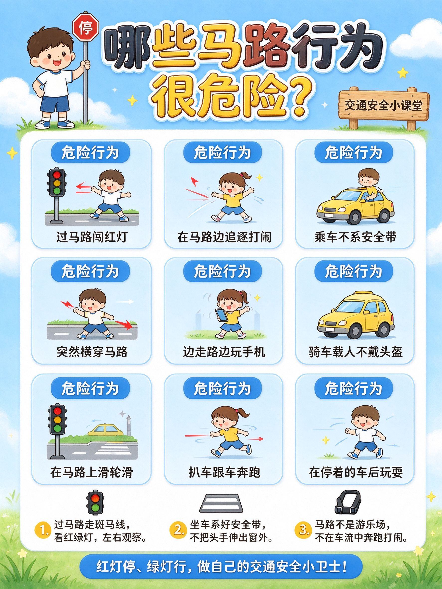

# 🖼️ Kid Science Poster

**儿童卡通科普信息海报生成器（AI Agent Skill）**

一个专门生成 **儿童 / 小学生科普信息海报、手抄报、知识长图、安全健康教育宣传图** 的 AI Agent 技能（Skill）。输入一个科普主题（如食品安全、防溺水、交通安全、垃圾分类、健康常识），即可自动产出同款风格的明亮 Q 版卡通竖版海报。

> 画面风格基准：Q 版卡通 + 蓝天草地 + 圆角信息卡片 + 粗黑轮廓平涂上色 + 干净可爱、低龄友好、排版规整。

---

## ✨ 特性

- **一键换主题**：只需改动标题、条目、小贴士、标语四处参数，即可生成不同科普主题海报
- **内置绘图模板**：含可直接投喂文生图模型的完整 prompt（正向 + 负面）
- **多布局支持**：3×3 默认 / 2×4 / 4×3 / 单列长卡片
- **多画风支持**：明亮卡通（默认）/ 马克笔手绘 / 水彩 / 线稿涂色版 / 双语版
- **内置主题速配**：食品安全、防溺水、交通安全、垃圾分类等示例文案
- **面向低龄受众**：粗黑轮廓、平涂上色、色彩饱满而不刺眼、文字预留清晰排版

---

## 📁 目录结构

```
kid-science-poster/
├── SKILL.md                    # 核心：触发描述 + 绘图模板 + 参数逻辑
├── assets/
│   └── transportation-safety-poster.png   # 示例成品图（交通安全主题）
└── references/
    ├── layouts.md              # 信息卡布局变体（3×3 / 2×4 / 4×3 / 单列）
    └── styles.md               # 画风变体（马克笔 / 水彩 / 线稿涂色 / 双语）
```

| 文件 / 目录 | 作用 |
| --- | --- |
| `SKILL.md` | 技能入口。含触发条件、生成流程、正向绘图模板、负面词、参数表、主题速配 |
| `assets/` | 示例成品图，用于展示技能效果（可作仓库预览图） |
| `references/layouts.md` | 当需要切换信息卡行列布局时读取 |
| `references/styles.md` | 当需要切换画风（手绘 / 水彩 / 线稿涂色 / 双语）时读取 |

### 效果预览

本技能生成的典型成品（交通安全主题示例）：



---

## 🚀 安装

本技能是一个标准的 Agent Skill 文件夹。将 `kid-science-poster/` 整个文件夹放入你的 Agent **技能加载目录**即可被自动识别。

```text
<your-agent-skills-root>/kid-science-poster/
```

不同 Agent / 平台的技能根目录命名可能不同，常见有：

- `workspace/.user_skills/`
- `~/.agents/skills/`
- `~/.claude/skills/`
- 平台的「技能」目录 / 技能市场

请放入你实际使用的 Agent 所加载技能的位置。放置后无需额外配置，Agent 会在满足触发条件时自动调用该技能。

---

## 🧭 使用方式

### 触发场景

当向 Agent 提出以下任一类需求时，该技能会被自动调用：

- 做一张 **儿童科普 / 安全教育海报**（如食品安全、防溺水、交通安全、垃圾分类）
- 做 **小学生手抄报**、知识宣传图、健康常识配图
- “**像这张图一样 / 同款风格**”的科普海报

### 出图方式

本技能产出的是**绘图 prompt 与设计参数**。实际出图时，请配合你所用 Agent / 平台的**图像生成（text-to-image）能力**使用：

1. 告诉 Agent 科普主题（如“做个垃圾分类海报”）
2. Agent 自动填充所有可变参数
3. Agent 组合「正向绘图模板 + 主题参数 + 负面词」提交给文生图工具
4. 建议选择**竖版比例**（3:4 或 9:16）
5. 生成后如需微调：改布局、换角色、换配色、增减条目、换画风

---

## 🧩 参数表

| 参数 | 说明 | 示例（食品安全） | 示例（防溺水） |
| --- | --- | --- | --- |
| `主标题` | 顶部超大艺术字 | 哪些食物吃了可能会中毒？ | 哪些行为容易溺水危险？ |
| `侧边木牌文字` | 右上角小木牌副标题 | 饮食安全小课堂 | 防溺水安全小课堂 |
| `卡通人物` | 左上角角色（可换性别/动作） | 小男孩举手讲解 | 小女孩举警示牌 |
| `行数×列数` | 信息卡布局，默认 3×3 | 3×3 | 3×3 |
| `标签文字` | 卡片顶部标签 | 禁吃令 | 危险行为 |
| `物品类型` | 卡片内简笔画对象 | 食物 | 小朋友危险动作 |
| `条目列表` | 每条一个危害/物品，逗号分隔 | 结块发酸的牛奶、有苦味的花生瓜子… | 私自去河边玩水、陌生水域打捞… |
| `小贴士` | 3 条行动建议 | 发现食物变色果断丢弃… | 不去野外河塘水库、游泳家长陪同… |
| `底部标语` | 一句总结宣传语 | 不乱吃、会分辨，做自己的饮食安全小卫士！ | 不玩水、守规则，做自己的防溺水安全小卫士！ |

---

## ✍️ 绘图模板（核心）

本技能的核心是一套**四段式提示词模板**，可直接投喂文生图模型：

```text
竖版儿童科普海报，小学生手抄报风格，明亮清新卡通插画，柔和蓝天背景，角落云朵、小草、星星装饰，
左上角有一个{{卡通人物}}卡通形象，顶部超大醒目艺术字主标题：{{主标题}}，右侧小木牌写：{{侧边木牌文字}}。

画面主体是{{行数}}行×{{列数}}列的圆角浅蓝/浅色信息卡片，每个卡片上方彩色标签写【{{标签文字}}】，
卡片内是Q版简笔画{{物品类型}}，下方配一行中文文字说明，依次是：{{条目列表}}；

卡片下方区域是3个带序号的小贴士模块，带放大镜、冰箱、锅（或按主题替换图标）的卡通图标，
文字：1.{{小贴士[0]}} 2.{{小贴士[1]}} 3.{{小贴士[2]}}。

最底部{{颜色}}横幅，标语：{{底部标语}}

干净平涂上色，粗黑轮廓线，色彩饱和度适中，可爱治愈，低龄儿童友好，
排版规整对齐，文字清晰可读，4K高清，无畸形物体，所有文字排版预留清晰位置，不要文字错乱。
```

**必须同时附加的负面提示：**

```text
扭曲畸形，文字乱码，文字重叠，文字错乱，模糊，灰暗色调，写实照片，3D渲染，
复杂阴影，恐怖元素，多余杂物，人物崩坏，字体模糊，画面拥挤，裁剪不全
```

> 💡 重要文字请用中文引号 **“”** 括起来，模型才会将其视为“必须写出的字”。

---

## 🎨 布局与画风扩展

### 布局（见 `references/layouts.md`）

| 布局 | 条数 | 说明 |
| --- | --- | --- |
| 3×3（默认） | 9 | 标准九宫格信息卡 |
| 2×4 | 8 | 竖向更省空间 |
| 4×3 | 12 | 容纳更多条目 |
| 单列长卡片 | 不限 | 适合逐条强调 |

### 画风（见 `references/styles.md`）

| 画风 | 适用场景 |
| --- | --- |
| 明亮 Q 版卡通（默认） | 班级墙贴、电子屏展示 |
| 马克笔手绘 | 手绘质感、手抄报作业 |
| 水彩 | 柔和温馨风格 |
| 线稿涂色版 | 黑白线稿，可打印给孩子自己上色 |
| 双语版 | 中英对照科普 |

---

## 🧭 内置主题速配

| 主题 | 主标题示例 | 底部标语示例 |
| --- | --- | --- |
| 食品安全 | 哪些食物吃了可能会中毒？ | 不乱吃、会分辨，做自己的饮食安全小卫士！ |
| 防溺水 | 哪些行为容易溺水危险？ | 不玩水、守规则，做自己的防溺水安全小卫士！ |
| 交通安全 | 哪些马路行为很危险？ | 红灯停、绿灯行，做自己的交通安全小卫士！ |
| 垃圾分类 | 垃圾分几类，你能分对吗？ | 会分类、不乱丢，做自己的环保小卫士！ |

---

## ⚠️ 注意事项

- 本技能**产出的是提示词与设计参数**，本身不直接出图，需配合所用平台的文生图工具使用
- 文生图对**中文长文字**可能存在个别错字、改写，重要文案生成后需人工核对，必要时针对文字做一次修正
- 条目数量建议与信息卡格数一致（如 3×3 对应 9 条），避免空格或挤版
- 面向低龄儿童的画面应避免写实、恐怖、灰暗等元素，本技能已在负面词中加以约束

---

## 📄 开源许可

请依据你的实际需要选择开源协议（如 MIT）。本项目为提示词 / 技能工程内容，欢迎自由使用、改造与分享。

---

## 🙌 致谢

本技能版式灵感来源于「食品安全手抄报」儿童科普海报样例，并针对不同安全教育主题做了参数化扩展。
